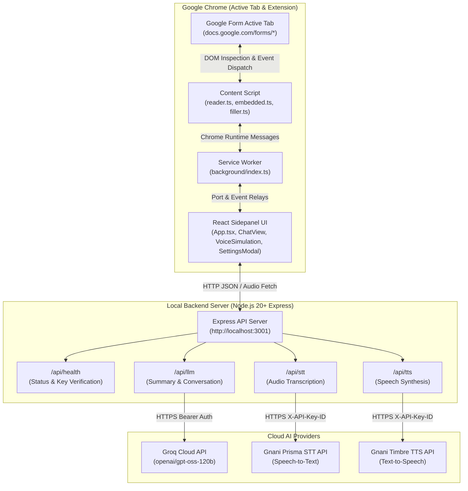
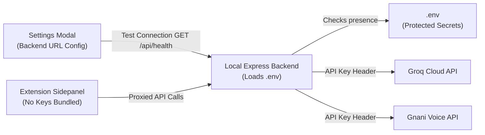
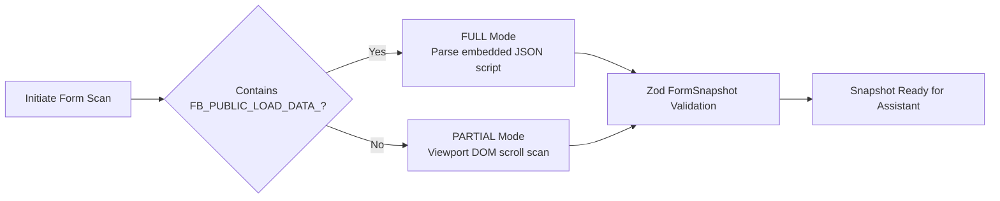

# Form Copilot

Form Copilot is a Chrome Extension (Manifest V3) and local AI service that reads Google Forms top-to-bottom, builds a structured snapshot, generates summaries in multiple languages, and provides a realtime multilingual voice and text assistant. It enables users to converse naturally in their preferred language (English, Hindi, Bengali, Tamil, Telugu, Kannada, Gujarati, Marathi), understand complex form requirements, and safely autofill fields on the active Google Form with explicit user confirmation.

---

## Key Highlights

- **Dual-Mode Form Parsing**: Extracts complete form structures directly from embedded page runtime scripts (`FB_PUBLIC_LOAD_DATA_`) with fallback to intelligent viewport DOM scanning.
- **Realtime Multilingual Voice Assistant**: Converse naturally with voice in and voice out powered by Gnani Prisma STT and Gnani Timbre TTS.
- **Intelligent Form Reasoning**: Powered by Groq's high-speed inference engine (`openai/gpt-oss-120b`) for form summarization, context-aware Q&A, and candidate answer generation.
- **Safe Closure/Wiz DOM Automation**: Accurately targets Google Forms internal DOM components, simulates native user typing and selection events, and prevents overwriting existing responses.
- **Strict User Control & Safety**: Never clicks Submit, Next, or Back automatically; requires explicit confirmation before filling any form control.
- **Glassmorphic Apple-Inspired Interface**: Clean, translucent sidepanel design with localized UI controls, live voice waveform animations, and realtime API configuration status checks.

---

## System Architecture



### Communication Flow

1. **Extraction**: The React sidepanel requests a form read. The background worker signals the content script on the active Google Forms tab to inspect the page.
2. **Snapshot Synthesis**: The content script extracts question titles, types, options, validation rules, and required flags, returning a validated `FormSnapshot` to the sidepanel.
3. **AI Summarization**: The sidepanel transmits the snapshot to the local backend `/api/llm` endpoint, where Groq compiles a structured overview in the user's chosen language.
4. **Voice & Text Dialogue**:
   - Voice audio is recorded in 16 kHz mono WAV via the browser MediaRecorder and dispatched to `/api/stt`.
   - Gnani Prisma returns high-accuracy transcripts.
   - Groq processes conversation turns against the form snapshot context.
   - Responses are spoken back via Gnani Timbre TTS (`/api/tts`).
5. **Form Automation**: When the user approves an answer or says "move to form filling", the sidepanel sends a typed fill command to the content script, which focuses the element, dispatches synthetic events, and updates the form state.

---

## API Keys & Security Architecture

Form Copilot enforces a strict credential isolation model:



### 1. Backend Configuration (.env)
All API credentials reside exclusively on the local Node.js backend inside `.env` at the repository root. Keys are never embedded into frontend assets, manifest files, git history, or client network requests.

```env
# Server Port (default: 3001)
PORT=3001

# Groq Cloud API Credentials (Required for form summarization and conversational agent)
# Documentation: https://console.groq.com
GROQ_API_KEY=your_groq_api_key_here
GROQ_API=your_groq_api_key_here
GROQ_MODEL=openai/gpt-oss-120b

# Gnani Voice API Credentials (Required for Speech-to-Text and Text-to-Speech)
# Documentation: https://docs.gnani.ai
GNANI_API_KEY=your_gnani_api_key_here
GNANI_API=your_gnani_api_key_here

# Allowed Chrome Extension Origin Pattern
ALLOWED_ORIGIN=chrome-extension://*
```

> [!IMPORTANT]
> The backend automatically accepts both `GROQ_API_KEY` / `GROQ_API` and `GNANI_API_KEY` / `GNANI_API` syntax. A sanitized `.env.example` is provided in the repository root and `backend/` directory.

### 2. Frontend Configuration & Health Verification
The extension sidepanel communicates with the backend over a configurable URL (default: `http://localhost:3001`).

- **Settings Modal**: Accessible from the sidepanel header, allowing users to configure the backend server endpoint.
- **Test Connection & API Status**: Clicking **Test Connection** in the Settings modal issues a probe to `/api/health`. The backend returns the live connectivity status and key presence flags (`configured: { groq: boolean, gnani: boolean }`) without disclosing the underlying secrets.
- **Live Status Badges**: Displays instantaneous green/amber feedback indicating whether the backend daemon is online and whether Groq and Gnani keys are active.

---

## Form Ingestion Modes



### 1. FULL Mode (Embedded Script Parsing)
Google Forms embeds its complete form schema within an inline `<script>` tag containing the variable `FB_PUBLIC_LOAD_DATA_`. 
- **Mechanism**: The content script locates and extracts this array structure, resolving questions across all pages, item IDs, types, validation rules, and branching logic even before the user navigates past page one.
- **Efficiency**: Instantaneous capture without requiring viewport scrolling or simulated interaction.

### 2. PARTIAL Mode (Visible DOM Scanning Fallback)
If the embedded data blob is omitted, obfuscated, or rendered dynamically:
- **Mechanism**: The content script activates `dom-scan.ts` and `scroll.ts`, performing controlled downward viewport scrolls in increments of 80% viewport height.
- **Safety Caps**: Monitored with a maximum limit of 200 scroll steps and stopping when the document height remains stable across 3 consecutive frames.
- **Restoration**: The original scroll position is saved and seamlessly restored upon completion.

---

## Form Filling Automation Engine

Google Forms employs the Google Wiz and Closure component frameworks. Simple property mutations (such as `input.value = "text"`) do not trigger internal form model updates. Form Copilot's `filler.ts` implements compliant synthetic event dispatching:

- **Text & Paragraph Fields**: Focuses the target `input` or `textarea`, sets the native value property descriptor, and dispatches sequential `keydown`, `input`, `change`, and `blur` events.
- **Radio & Multiple Choice Options**: Locates the matching `[role="radio"]` element by label text or value index, clicks the target element, and triggers `change` events.
- **Checkboxes**: Evaluates desired states and selectively dispatches click events to `[role="checkbox"]` elements without deselecting prior valid selections.
- **Dropdowns & Select Menus**: Interacts with `[role="listbox"]` containers, selecting candidate option rows.
- **Specialized Fields (Dates, Times, File Uploads)**: When direct automation is restricted by browser security policies (such as OS file dialogs), the assistant highlights the question and guides the user via voice or on-screen prompt to complete the selection manually.
- **Overwrite Protection**: Form Copilot verifies existing control values. If a field already contains user input, the assistant will not overwrite it without confirmation.

---

## Multilingual Support

Form Copilot provides end-to-end language continuity across both UI text and voice conversation:

| Language | Locale Code | Gnani STT Code | Gnani TTS Lang Code |
| :--- | :--- | :--- | :--- |
| **English** | `en` | `en-IN` | `en` |
| **Hindi** | `hi` | `hi` | `hi` |
| **Bengali** | `bn` | `bn` | `bn` |
| **Tamil** | `ta` | `ta` | `ta` |
| **Telugu** | `te` | `te` | `te` |
| **Kannada** | `kn` | `kn` | `kn` |
| **Gujarati** | `gu` | `gu` | `gu` |
| **Marathi** | `mr` | `mr` | `mr` |

> [!NOTE]
> When a user selects a language from the dropdown, the selection locks both Groq system prompts and Gnani STT/TTS models to that language, preventing unintended code-switching.

---

## Project Scopes and Boundaries

### In Scope
- Google Forms public and authenticated view URLs (`https://docs.google.com/forms/*`).
- Reading single-page and multi-page forms.
- Structured summarization (purpose, required questions, estimated completion time).
- Multilingual voice conversation and step-by-step form filling.
- Single-field and multi-field autofill with user confirmation.

### Out of Scope (Strict Hard Rules)
- **No Automated Form Submission**: Form Copilot strictly forbids clicking `Submit`, `Next`, or `Back` buttons. Navigation and final submission remain under user control.
- **No Non-Google Form Sites**: The extension will not execute on generic web pages or non-Google form builders.
- **No Direct Third-Party API Calls from Extension**: The extension communicates exclusively with its local backend server. Groq and Gnani API credentials reside solely in the backend environment.
- **No Untracked Data Storage**: Form snapshots remain in memory and are discarded upon tab close or reset. `chrome.storage.local` is restricted to user configuration settings.

---

## Repository Structure

```
VoiceForm/
├── .env                              # Local active credentials (Git ignored)
├── .env.example                      # Template for environment configuration
├── .gitignore                        # Git ignore specifications
├── agent.md                          # Architectural rules and boundary invariants
├── package.json                      # Monorepo root workspace configuration
├── package-lock.json                 # Pinned dependencies lockfile
├── playwright.config.ts              # Playwright end-to-end testing configuration
├── vitest.config.ts                  # Vitest unit testing configuration
├── README.md                         # Project documentation
│
├── backend/                          # Local Node.js Express API service
│   ├── .env.example                  # Backend-specific environment template
│   ├── package.json                  # Backend dependencies and scripts
│   ├── tsconfig.json                 # Backend TypeScript compiler settings
│   └── src/
│       ├── server.ts                 # Express initialization, CORS, and /api/health
│       ├── lib/
│       │   ├── gnani.ts              # Gnani Prisma v3/v2.5 STT & Timbre v2.5 TTS client
│       │   └── groq.ts               # Groq LLM client with token management
│       └── routes/
│           ├── llm.ts                # /api/llm/summary & /api/llm/chat endpoints
│           ├── stt.ts                # /api/stt audio transcription endpoint
│           └── tts.ts                # /api/tts speech synthesis endpoint
│
├── extension/                        # Chrome Manifest V3 Extension
│   ├── manifest.config.ts            # Manifest V3 specification
│   ├── package.json                  # Extension dependencies and scripts
│   ├── tsconfig.json                 # Extension TypeScript compiler settings
│   ├── vite.config.ts                # Vite + CRXJS packaging pipeline
│   ├── tailwind.config.js            # Glassmorphic Tailwind styling theme
│   ├── postcss.config.js             # PostCSS plugin pipeline
│   ├── permission.html               # Audio permission request document
│   └── src/
│       ├── permission.ts             # Microphone permission trigger script
│       ├── background/
│       │   └── index.ts              # Extension service worker (sidepanel & tab relay)
│       ├── content/
│       │   ├── index.ts              # Content script runtime entrypoint
│       │   ├── reader.ts             # Form reading coordinator
│       │   ├── embedded.ts           # FB_PUBLIC_LOAD_DATA_ script extractor (FULL mode)
│       │   ├── dom-scan.ts           # Viewport DOM scanner (PARTIAL mode fallback)
│       │   ├── filler.ts             # Closure/Wiz event simulator & form filler
│       │   ├── scroll.ts             # Controlled viewport step-scroller
│       │   ├── overlay.ts            # Visual scanning progress indicator
│       │   └── selectors.ts          # Centralized Google Forms DOM selectors
│       ├── settings/
│       │   └── index.ts              # Backend URL storage & health check helper
│       └── sidepanel/
│           ├── App.tsx               # Root sidepanel state engine and UI shell
│           ├── index.tsx             # React mount entrypoint
│           ├── index.html            # Sidepanel host HTML document
│           ├── index.css             # Glassmorphic styles and custom scrollbars
│           ├── i18n.ts               # Multilingual dictionary for UI strings
│           ├── languages.ts          # Language metadata and dialect definitions
│           ├── useVoiceSimulation.ts # Realtime voice conversational state machine
│           ├── wav-recorder.ts       # 16 kHz mono WAV audio recorder
│           └── components/
│               ├── ChatView.tsx      # Realtime conversation interface
│               ├── VoiceFillingSimulation.tsx # Voice assistant card with radar aura
│               ├── SummaryCard.tsx   # Form overview and statistics card
│               ├── QuestionNav.tsx   # Step-by-step question navigation list
│               ├── LanguageSelector.tsx # Multilingual dropdown selector
│               ├── SettingsModal.tsx # Backend URL config & live API health tester
│               ├── DiagnosticsModal.tsx # Form snapshot and selector inspector
│               └── ConfirmModal.tsx  # Confirmation dialog prior to filling
│
├── shared/                           # Shared schemas and message contracts
│   ├── package.json                  # Shared package manifest
│   ├── tsconfig.json                 # Shared TypeScript compiler settings
│   ├── index.ts                      # Barrel export file
│   ├── schema.ts                     # Zod schemas: FormSnapshot, FormSummary, FillResult
│   └── messages.ts                   # Typed message protocol across extension layers
│
└── tests/                            # Automated test suites
    ├── fixtures/                     # Offline Google Form HTML documents
    │   ├── form-a-single-page.html   # Single-page test form fixture
    │   └── form-b-multi-page.html    # Multi-page branching test form fixture
    ├── unit/                         # Vitest unit test files
    │   ├── embedded.test.ts          # FB_PUBLIC_LOAD_DATA_ extraction tests
    │   └── schema.test.ts            # Zod validation schema tests
    └── e2e/                          # Playwright end-to-end integration tests
        └── fixtures.spec.ts          # 6 browser acceptance tests
```

### Module Responsibilities

| Module | Purpose |
| :--- | :--- |
| **`backend`** | Manages external AI provider communication (Groq and Gnani), keeps API keys secure, and handles audio encoding/decoding. |
| **`extension/background`** | Service worker that activates the Chrome sidepanel on form tabs and relays cross-context runtime messages. |
| **`extension/content`** | Executes directly inside the active Google Form tab to extract DOM data and simulate native keyboard and click events. |
| **`extension/sidepanel`** | React 18 frontend providing the glassmorphic user interface, chat dialogue, voice recording, and control settings. |
| **`shared`** | Houses shared Zod validation schemas and TypeScript message interfaces used by both the backend and extension. |
| **`tests`** | Unit and end-to-end test suites executing against offline Google Form fixtures without requiring live network access. |

---

## Git Ignore Configuration

The project's `.gitignore` protects credentials and keeps the repository clean:

- **Environment Secrets**: Blocks `.env`, `.env.*`, and cryptographic certificates (`*.pem`, `*.key`) while allowing `.env.example`.
- **Build Artifacts**: Excludes `dist/`, `build/`, `out/`, and `*.tsbuildinfo` compiler output.
- **Test Artifacts**: Ignores `coverage/`, `playwright-report/`, and `test-results/`.
- **Runtime Audio**: Excludes temporary audio recordings (`*.wav`, `*.mp3`, `*.webm`).
- **Dependencies & Caches**: Excludes `node_modules/`, `.cache/`, and `.vite/`.
- **Editor & OS Metadata**: Ignores `.DS_Store`, `Thumbs.db`, `.vscode/`, and `.idea/`.

---

## Getting Started

### Prerequisites

- **Node.js**: Version 20.0.0 or higher
- **npm**: Version 10.0.0 or higher
- **Google Chrome**: Version 116 or higher (with Side Panel API support)
- **API Keys**:
  - [Groq API Key](https://console.groq.com)
  - [Gnani API Key](https://docs.gnani.ai)

### 1. Installation

Clone the repository and install dependencies across all workspace packages:

```bash
git clone https://github.com/your-repo/VoiceForm.git
cd VoiceForm
npm install
```

### 2. Environment Configuration

Create a `.env` file in the project root:

```env
PORT=3001
GROQ_API_KEY=your_groq_api_key_here
GNANI_API_KEY=your_gnani_api_key_here
GROQ_MODEL=openai/gpt-oss-120b
```

> [!IMPORTANT]
> Never commit your `.env` file or expose your API keys in frontend extension builds.

### 3. Build Packages

Compile the shared schema module and the Chrome extension:

```bash
# Build shared library
npm --workspace=shared run build

# Build Chrome extension
npm --workspace=extension run build

# Build backend
npm --workspace=backend run build
```

### 4. Start the Local Backend Server

```bash
npm --workspace=backend run start
```

The service will start on `http://localhost:3001` with endpoints ready:
- `GET  /api/health`
- `POST /api/llm/summary`
- `POST /api/llm/chat`
- `POST /api/stt`
- `POST /api/tts`

### 5. Load the Extension in Google Chrome

1. Open Google Chrome and navigate to `chrome://extensions/`.
2. Enable **Developer mode** using the toggle switch in the top right.
3. Click **Load unpacked**.
4. Select the build directory: `VoiceForm/extension/dist`.
5. Open any Google Form (for example, `https://docs.google.com/forms/d/e/.../viewform`).
6. Click the **Form Copilot** extension icon in your browser toolbar to open the sidepanel.

---

## Usage Guide

1. **Select Language**: Choose your desired communication language (e.g. English, Hindi, Tamil) from the dropdown.
2. **Review Form Summary**: Inspect the high-level overview detailing form objectives, question counts, and required items.
3. **Verify API Status**: Open **Settings** from the header and click **Test Connection** to confirm backend connectivity and active API key status.
4. **Interactive Text Chat**: Type queries regarding question meanings, phrasing recommendations, or required documents.
5. **Voice Filling Mode**:
   - Click **Start Voice** (or grant microphone access via the permission prompt).
   - The assistant introduces itself in the chosen language.
   - Speak your response naturally.
   - For open-ended questions, review generated suggestions.
   - Confirm candidate responses before they are populated on the active Google Form tab.
6. **Form Diagnostics**: Access the **Diagnostics** panel from the header to inspect the raw `FormSnapshot`, execution mode (`FULL` or `PARTIAL`), and question selectors.

---

## Testing and Verification

Form Copilot includes comprehensive unit and integration suites verifying schema integrity, embedded script extraction, and end-to-end form interaction.

### Run Unit Tests (Vitest)

```bash
npm run test
```

Verifies Zod schema validation rules, snapshot boundary parsing, and script extraction logic.

### Run End-to-End Tests (Playwright)

```bash
npm run test:e2e
```

Executes automated browser verification against single-page and multi-page form fixtures in `tests/fixtures/`.

---

## Security and Compliance

- **No Key Leaks**: All cloud communication is proxied through the local Express daemon. Content scripts and extension bundles never store API keys.
- **Content Security Policy**: Manifest V3 compliant with zero `eval()`, zero dynamic inline scripts, and sandboxed storage limits.
- **Non-Destructive Automation**: Field modifications respect current page states without overriding completed questions. Forms cannot be submitted programmatically.
# Form-Copilot

