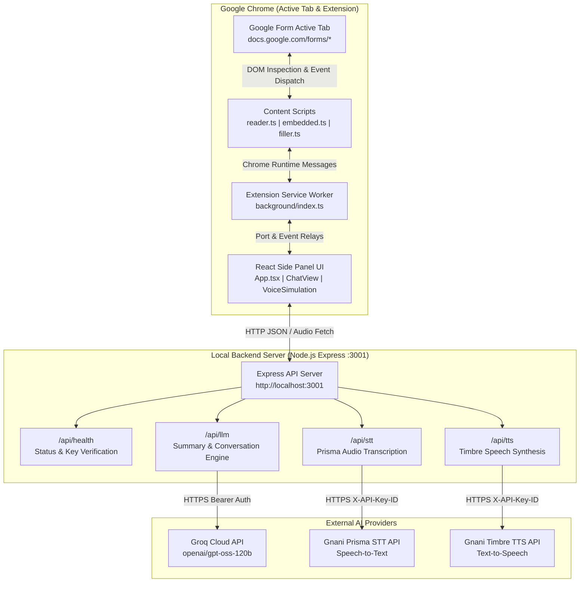
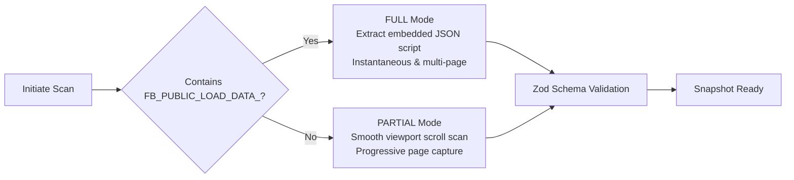
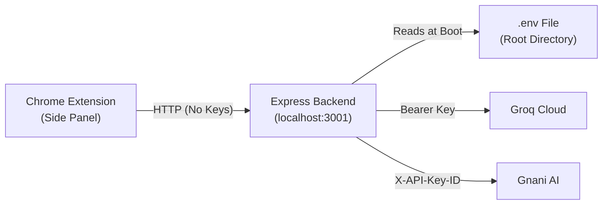

<div align="center">

# Form Copilot

### Realtime Multilingual AI & Voice Assistant for Google Forms

[](https://developer.chrome.com/docs/extensions/mv3/intro/)
[](https://react.dev)
[](https://www.typescriptlang.org/)
[](https://console.groq.com)
[](https://docs.gnani.ai)
[](https://nodejs.org)
[](https://vitest.dev)
[](https://playwright.dev)

<p align="center">
  Form Copilot transforms how users interact with Google Forms by delivering intelligent top-to-bottom form parsing, instant multilingual summarization, hands-free voice dialogue in native Indian languages, and safe, user-confirmed autofill directly into Google Forms.
</p>

<p align="center">
  <a href="#overview">Overview</a> &bull;
  <a href="#architecture">Architecture</a> &bull;
  <a href="#core-capabilities">Capabilities</a> &bull;
  <a href="#api-keys--security">API Keys & Security</a> &bull;
  <a href="#multilingual-matrix">Languages</a> &bull;
  <a href="#project-structure">Project Structure</a> &bull;
  <a href="#quick-start">Quick Start</a> &bull;
  <a href="#testing">Testing</a>
</p>

</div>

---

## Overview

Filling long or complex Google Forms can be intimidating, especially when navigating unfamiliar technical phrasing or completing forms in a non-native language. Form Copilot runs natively as a Chrome Side Panel alongside Google Forms (`https://docs.google.com/forms/*`) to provide:

1. **Automated Structure Extraction**: Instant form analysis via embedded data parsing (`FB_PUBLIC_LOAD_DATA_`) or fallback viewport DOM scrolling.
2. **Context-Aware Summaries**: Understand form goals, section branches, required inputs, and estimated time to complete.
3. **Conversational Assistant**: Ask questions in real time via text or speech (English, Hindi, Bengali, Tamil, Telugu, Kannada, Gujarati, Marathi).
4. **Interactive Voice Form Filling**: Step through questions conversationally with voice input and voice playback, reviewing suggested answers before they are applied.
5. **Safe Event-Driven Automation**: Accurately triggers Google Forms' internal Closure/Wiz state machines without overwriting existing data or submitting forms automatically.

---

## Architecture

Form Copilot separates duties across browser client contexts, a local Node.js proxy service, and cloud inference APIs to guarantee security and zero key leakage:



### Communication Pipeline

| Step | Initiator | Target | Protocol / Payload | Description |
| :--- | :--- | :--- | :--- | :--- |
| **1. Form Scan** | Sidepanel | Content Script | `SCAN_FORM` message | Background worker relays request; content script extracts question schema. |
| **2. Snapshot** | Content Script | Sidepanel | `FormSnapshot` JSON | Returns validated snapshot conforming to `FormSnapshotSchema`. |
| **3. Summarization** | Sidepanel | Backend (`/api/llm/summary`) | HTTP POST JSON | Trims snapshot to token budget; Groq generates structured multi-language overview. |
| **4. Voice Capture** | Sidepanel | Backend (`/api/stt`) | HTTP POST (16 kHz WAV) | Transcribes microphone speech via Gnani Prisma v3.0 / v2.5. |
| **5. AI Dialogue** | Sidepanel | Backend (`/api/llm/chat`) | HTTP POST JSON | Groq evaluates user speech against form questions and returns structured guidance. |
| **6. Voice Output** | Sidepanel | Backend (`/api/tts`) | HTTP POST JSON | Synthesizes response speech using Gnani Timbre v2.5; plays back in sidepanel. |
| **7. Field Fill** | Sidepanel | Content Script | `FILL_FIELD` message | Simulates user input and native Closure/Wiz events with explicit confirmation. |

---

## Core Capabilities

### 1. Dual-Mode Form Ingestion

Form Copilot adapts dynamically to form size, complexity, and rendering method:



- **FULL Mode (Embedded Parsing)**: Parses Google Forms' internal `FB_PUBLIC_LOAD_DATA_` payload directly from script tags. Instantly uncovers all questions across all pages, branching conditions, validation patterns, and choices before the user navigates.
- **PARTIAL Mode (DOM Scan Fallback)**: If scripts are stripped or modified, controlled viewport stepping scans visible sections in 80% viewport increments, capping at 200 cycles with automatic scroll restoration and visual progress feedback.

### 2. Event-Accurate Form Automation

Google Forms uses custom web components that ignore primitive DOM property assignments. Form Copilot's `filler.ts` dispatches native synthetic events matching the internal state machines:

- **Text Inputs & Textareas**: Sets native value descriptors followed by sequential `keydown`, `input`, `change`, and `blur` events.
- **Radio Buttons**: Resolves candidate radio options by value index or label text and triggers native click and change handlers.
- **Checkboxes**: Evaluates desired states and checks boxes without unselecting prior entries.
- **Dropdown Lists**: Interacts with `[role="listbox"]` containers to select appropriate option rows.
- **Security-Restricted Fields**: Dates, times, and file uploads prompt user manual completion in their native language rather than risking malformed inputs.
- **Overwrite Protection**: Form Copilot checks existing values and will never overwrite user-entered fields without explicit instruction.

### 3. Apple-Inspired Glassmorphic UI

The sidepanel is designed with a modern, distraction-free aesthetic:

- **Translucent Frosted Panels**: Layered backdrop blur (`backdrop-filter: blur(12px)`), subtle borders, and smooth shadows.
- **Pulsing Audio Radar**: Live dynamic waveform animation indicating when the assistant is listening, thinking, or speaking.
- **Integrated Health Inspector**: A dedicated Settings modal that lets users verify backend connectivity and test Groq and Gnani key readiness in real time.
- **Live Diagnostics**: Inspect raw snapshots, detected scan mode, warning logs, and question element targets.

---

## API Keys & Security

Form Copilot maintains a zero-trust credential model.

> [!IMPORTANT]
> API keys are never bundled into extension files, manifests, content scripts, or network calls from the browser. All third-party AI requests are proxied securely through the local backend.



### Backend `.env` Specification

Create a `.env` file in the project root:

```env
# Server Port (default: 3001)
PORT=3001

# Groq Cloud API Credentials (Required for form summarization and conversational agent)
# Documentation: https://console.groq.com
GROQ_API_KEY=your_groq_api_key_here
GROQ_API=your_groq_api_key_here
GROQ_MODEL=openai/gpt-oss-120b

# Gnani Voice API Credentials (Required for Speech-to-Text and Text-to-Speech)
# Documentation: https://docs.gnani.ai
GNANI_API_KEY=your_gnani_api_key_here
GNANI_API=your_gnani_api_key_here

# Allowed Chrome Extension Origin Pattern
ALLOWED_ORIGIN=chrome-extension://*
```

### Health Verification Endpoint

The backend provides a safe health inspection route:

```http
GET /api/health
```

**Example Response**:
```json
{
  "status": "ok",
  "timestamp": "2026-11-10T04:39:15.908Z",
  "service": "Form Copilot Backend",
  "configured": {
    "groq": true,
    "gnani": true
  }
}
```

The extension Settings modal uses this endpoint to display live status badges (**Online / Offline**, **Configured / Missing**) without exposing keys.

---

## Multilingual Matrix

Form Copilot features unified language locking: changing the language dropdown updates UI text, Groq conversational instructions, and Gnani STT/TTS engine dialects simultaneously:

| Language | Locale Code | Gnani STT Dialect | Gnani TTS Code | UI Localization |
| :--- | :--- | :--- | :--- | :--- |
| **English** | `en` | `en-IN` | `en` | Full English UI |
| **Hindi** | `hi` | `hi` | `hi` | Full Hindi UI |
| **Bengali** | `bn` | `bn` | `bn` | Localized Prompts |
| **Tamil** | `ta` | `ta` | `ta` | Localized Prompts |
| **Telugu** | `te` | `te` | `te` | Localized Prompts |
| **Kannada** | `kn` | `kn` | `kn` | Localized Prompts |
| **Gujarati** | `gu` | `gu` | `gu` | Localized Prompts |
| **Marathi** | `mr` | `mr` | `mr` | Localized Prompts |

---

## Project Structure

```
VoiceForm/
├── .env                              # Active environment credentials (git-ignored)
├── .env.example                      # Template for environment configuration
├── .gitignore                        # Git exclusion rules
├── agent.md                          # Architectural invariants and boundary rules
├── package.json                      # Monorepo root workspaces configuration
├── package-lock.json                 # Dependency lockfile
├── playwright.config.ts              # Playwright test configuration
├── vitest.config.ts                  # Vitest test configuration
├── README.md                         # Project documentation
│
├── backend/                          # Local Node.js Express API service
│   ├── .env.example                  # Backend template for environment settings
│   ├── package.json                  # Backend dependencies and scripts
│   ├── tsconfig.json                 # TypeScript compiler configuration
│   └── src/
│       ├── server.ts                 # Server startup, CORS, and /api/health
│       ├── lib/
│       │   ├── gnani.ts              # Gnani Prisma STT & Timbre TTS client
│       │   └── groq.ts               # Groq LLM client with token management
│       └── routes/
│           ├── llm.ts                # Form summarization and chat endpoints
│           ├── stt.ts                # Audio transcription endpoint
│           └── tts.ts                # Speech synthesis endpoint
│
├── extension/                        # Chrome Manifest V3 Extension
│   ├── manifest.config.ts            # Manifest V3 configuration
│   ├── package.json                  # Extension dependencies and scripts
│   ├── tsconfig.json                 # Extension TypeScript compiler settings
│   ├── vite.config.ts                # Vite + CRXJS packaging pipeline
│   ├── tailwind.config.js            # Glassmorphic Tailwind styling
│   ├── postcss.config.js             # PostCSS build pipeline
│   ├── permission.html               # Audio permission request document
│   └── src/
│       ├── permission.ts             # Microphone access handler
│       ├── background/
│       │   └── index.ts              # Background service worker (sidepanel relay)
│       ├── content/
│       │   ├── index.ts              # Content script runtime entrypoint
│       │   ├── reader.ts             # Reader orchestrator (FULL & PARTIAL modes)
│       │   ├── embedded.ts           # FB_PUBLIC_LOAD_DATA_ script extractor
│       │   ├── dom-scan.ts           # Fallback visible DOM scanner
│       │   ├── filler.ts             # Closure/Wiz event simulator
│       │   ├── scroll.ts             # Smooth viewport scrolling utility
│       │   ├── overlay.ts            # Scanning progress indicator
│       │   └── selectors.ts          # Central Google Forms DOM selectors
│       ├── settings/
│       │   └── index.ts              # Backend URL persistence & health client
│       └── sidepanel/
│           ├── App.tsx               # Root application state machine & UI shell
│           ├── index.tsx             # React mount entrypoint
│           ├── index.html            # Sidepanel host HTML document
│           ├── index.css             # Glassmorphic styles and custom scrollbars
│           ├── i18n.ts               # Multilingual translations dictionary
│           ├── languages.ts          # Language catalog and dialect configurations
│           ├── useVoiceSimulation.ts # Realtime voice conversational state hook
│           ├── wav-recorder.ts       # 16 kHz mono WAV audio recording
│           └── components/
│               ├── ChatView.tsx      # Realtime conversation interface
│               ├── VoiceFillingSimulation.tsx # Voice assistant card with radar aura
│               ├── SummaryCard.tsx   # Form overview and statistics card
│               ├── QuestionNav.tsx   # Step-by-step question list
│               ├── LanguageSelector.tsx # Multilingual dropdown selector
│               ├── SettingsModal.tsx # Backend URL config & live API health tester
│               ├── DiagnosticsModal.tsx # Form snapshot and selector inspector
│               └── ConfirmModal.tsx  # Confirmation dialog prior to filling
│
├── shared/                           # Shared schemas and message contracts
│   ├── package.json                  # Shared package manifest
│   ├── tsconfig.json                 # Shared TypeScript compiler settings
│   ├── index.ts                      # Barrel export file
│   ├── schema.ts                     # Zod schemas: FormSnapshot, FormSummary, FillResult
│   └── messages.ts                   # Typed message protocol across extension layers
│
└── tests/                            # Automated test suites
    ├── fixtures/                     # Offline Google Form HTML documents
    │   ├── form-a-single-page.html   # Single-page test form fixture
    │   └── form-b-multi-page.html    # Multi-page branching test form fixture
    ├── unit/                         # Vitest unit test files
    │   ├── embedded.test.ts          # FB_PUBLIC_LOAD_DATA_ extraction tests
    │   └── schema.test.ts            # Zod validation schema tests
    └── e2e/                          # Playwright end-to-end integration tests
        └── fixtures.spec.ts          # 6 browser acceptance tests
```

---

## Quick Start

### 1. Clone & Install

```bash
git clone https://github.com/your-repo/VoiceForm.git
cd VoiceForm
npm install
```

### 2. Configure Environment

Copy `.env.example` to `.env` and insert your API keys:

```bash
cp .env.example .env
```

Edit `.env`:
```env
PORT=3001
GROQ_API_KEY=gsk_your_groq_api_key
GNANI_API_KEY=vach_your_gnani_api_key
```

### 3. Build Workspaces

```bash
# Build shared library schemas
npm --workspace=shared run build

# Build Chrome Extension
npm --workspace=extension run build

# Build Backend Server
npm --workspace=backend run build
```

### 4. Start Local Backend

```bash
npm --workspace=backend run start
```
*Server starts on `http://localhost:3001`.*

### 5. Load in Chrome

1. Navigate to `chrome://extensions/` in Google Chrome.
2. Toggle on **Developer mode** in the upper right.
3. Click **Load unpacked** and select `VoiceForm/extension/dist`.
4. Open any Google Form (`docs.google.com/forms/*`).
5. Click the **Form Copilot** extension icon to open the sidepanel.

---

## Scopes & Invariants

| Rule | Enforcement |
| :--- | :--- |
| **Scope Boundary** | Operates strictly on `https://docs.google.com/forms/*`. Ignored on all other URLs. |
| **No Auto-Submit** | Never clicks `Submit`, `Next`, or `Back` in reader mode. Form submission remains entirely user-controlled. |
| **No Silent Overwrites** | Pre-existing input values are never overwritten without explicit user confirmation. |
| **Confirmation Required** | Form filling actions require explicit user approval via sidepanel button or voice confirmation. |
| **Zero Extension Secrets** | Extension bundle and network traffic contain zero API keys. All calls proxy through the local backend. |
| **Clean Design Standards** | Translucent Apple-style glassmorphism with zero emojis in code, UI, or markdown documents. |

---

## Testing

Form Copilot includes automated unit and end-to-end test suites run against offline Google Form fixtures:

```bash
# Run Vitest unit tests (schema validation & embedded parser)
npm run test

# Run Playwright acceptance tests (6 automated end-to-end checks)
npm run test:e2e
```

### Acceptance Checks Covered

- **Check 1**: Single-page form parsing accurately extracts all questions, types, and required flags.
- **Check 2**: Multi-page form FULL mode resolves all pages and branching logic.
- **Check 3**: Multi-page form PARTIAL mode captures visible pages with warnings and allows incremental addition.
- **Check 4**: Scanning overlay displays during extraction and cleans up reliably in `finally`.
- **Check 5**: Prevents clicks on Submit, Next, or Back navigation buttons.
- **Check 6**: Event simulation verifies text entry, radio selection, and overwrite protection.
